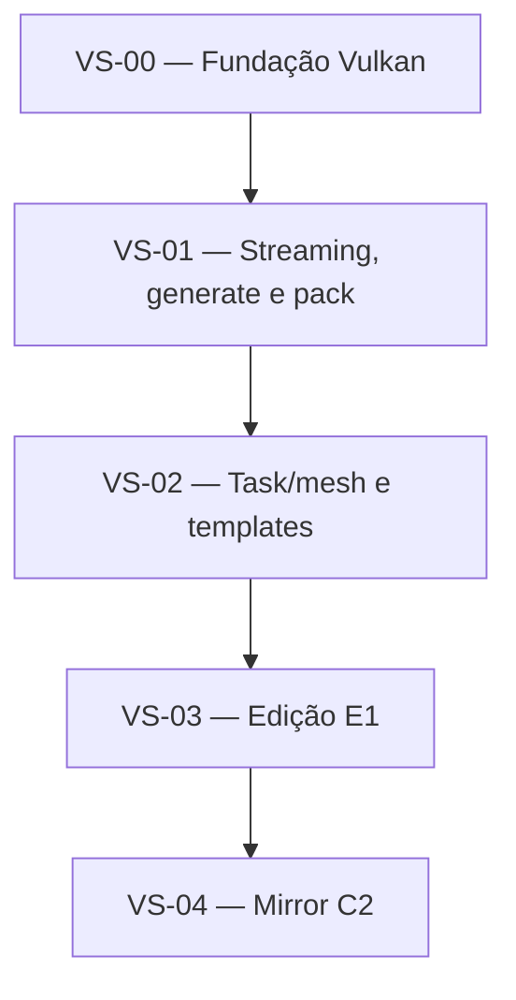

# Hierarquia de dependências

As dependências abaixo governam a ordem de aprovação e implementação. Rascunhos posteriores podem ser escritos antecipadamente, mas nenhuma fatia deve começar a ser implementada antes de suas predecessoras estarem concluídas e verificadas.

## Grafo

## Registro normativo

| Item | Depende de | Bloqueada por | Libera |
| --- | --- | --- | --- |
| [[VS-00-fundacao-vulkan|VS-00]] | — | — | VS-01 |
| [[VS-01-streaming-generate-pack|VS-01]] | VS-00 | — | VS-02 |
| [[VS-02-task-mesh-templates|VS-02]] | VS-01 | — | VS-03 |
| [[VS-03-edicao-e1|VS-03]] | VS-02 | — | VS-04 |
| [[VS-04-mirror-c2|VS-04]] | VS-03 | — | Consumidores futuros do mirror |

## Decisões incorporadas

- ADR-B5: VS-01 usa visão `8`, geração `8`, descarga `16` e 4.096 slots.
- ADR-B6: a correção visual de plantas é trabalho posterior e não integra o aceite de VS-02.
- ADR-B7: VS-02 usa Lambert + emissão; PBR é melhoria futura.
- ADR-B10: VS-02 renderiza sem estágio task — builder compute na fila gráfica anexa itens numa fila de trabalho global e o draw é mesh-only indireto (o payload task→mesh não era entregue pelo driver do ambiente).

## Dependências transversais a registrar nas specs

Estas relações não alteram a cadeia principal, mas precisam virar contratos explícitos:

- VS-00 deve fornecer as capabilities e a sincronização exigidas por todas as demais.
- VS-01 produz os formatos packed consumidos por VS-02, VS-03 e VS-04.
- VS-02 fornece o ponto de renderização no qual VS-03 aplica a barreira COMPUTE → COMPUTE(builder) | MESH (a fila de trabalho da ADR-B10 eliminou o estágio task).
- VS-03 fornece o journal e o feedback usados por VS-04.
- `common.slang` e os layouts Odin↔Slang são contratos compartilhados; mudanças neles exigem revisão de todas as specs afetadas.

## Regras

1. Referenciar dependências por ID no frontmatter e neste registro.
2. Não criar ciclos; uma dependência circular indica fronteira de módulo ou fatia mal definida.
3. `depende_de` representa dependência de implementação.
4. `bloqueada_por` representa decisão ou questão que impede a aprovação da spec.
5. Ao alterar o grafo, atualizar também as specs afetadas e o [[status|painel de status]].
6. Novas dependências transversais devem indicar o contrato necessário, não apenas o nome do módulo.
